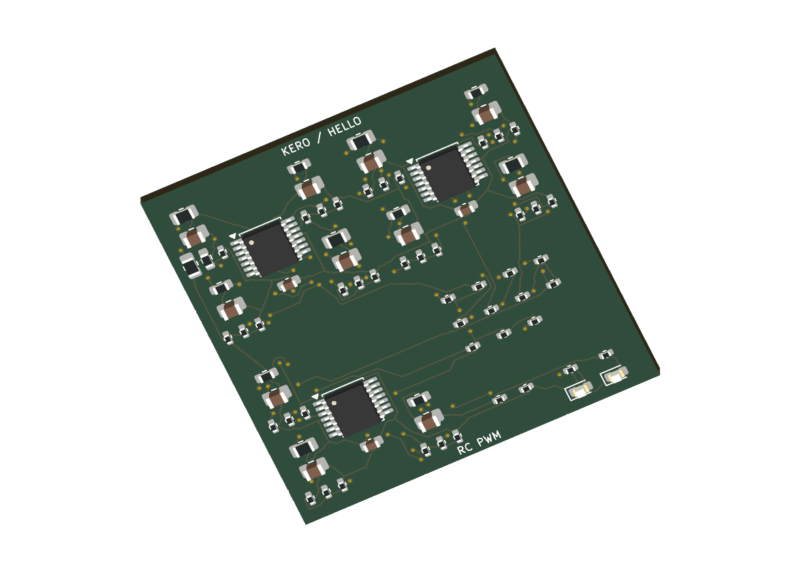
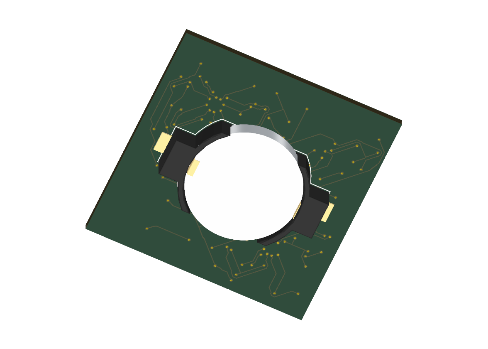
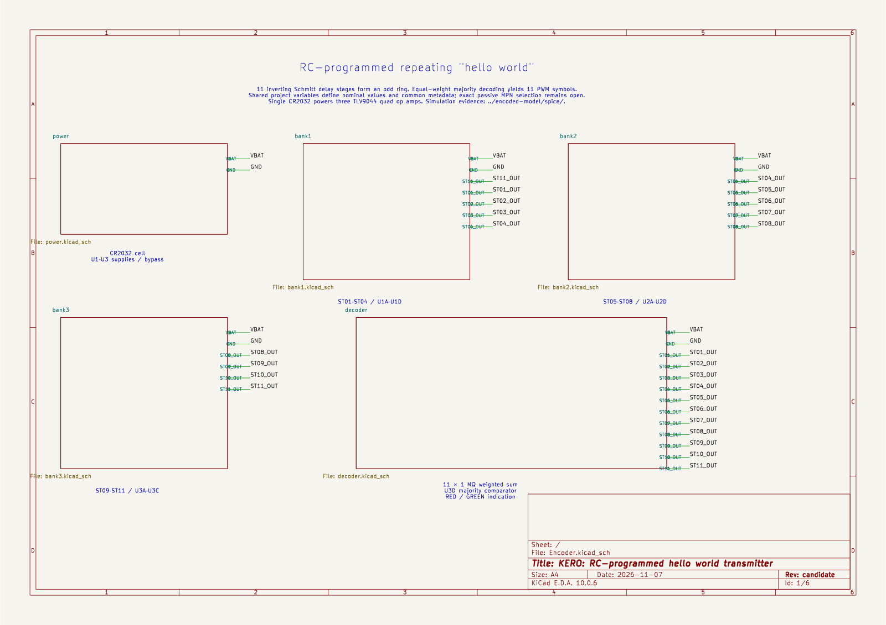
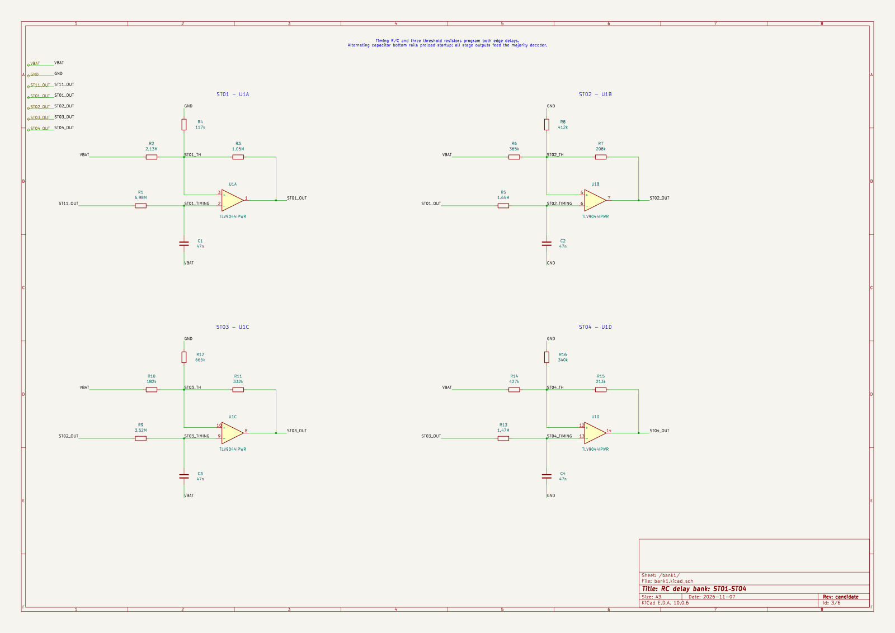

# KERO — RC-programmed hello world pulse encoder

> **AI hardware-design experiment:** KERO evaluates AI-generated electronic schematics and PCB layouts. This is an experimental design for engineering review; hardware has not been built or bench tested.

One **CR2032** powers a repeating `hello world` pulse encoder made from **three TLV9044IPWR quad op-amps**, resistors and capacitors, with red/green LED indication. R/C values program the pulse sequence. The complete encoder, local libraries, 3D models, BoM and saved analysis are included on `main` following [PR #16](https://github.com/wayri/KERO/pull/16).

## Open the encoder

Open [encoder/Encoder.kicad_pro](encoder/Encoder.kicad_pro) in **KiCad 10** (saved verification: 10.0.6). The two-layer board is **40 × 40 mm**, with the circuit on the front and coin-cell holder on the back.

- [Encoder guide](encoder/README.md) · [BoM](encoder/bom.csv) · [Pin/net design intent](encoder/design-intent.json)
- [Schematic and shared variables](encoder/SCHEMATIC.md) · [Timing architecture and R/C values](encoded-model/architecture.md)
- [Front copper](encoder/previews/board-front.svg) · [Back copper](encoder/previews/board-back.svg)
- [Power, PI and thermal analysis files](encoder/analysis/README.md)

All 79 fitted parts resolve local package models. The illustrated coin cell is a nominal envelope, not a manufacturer-qualified fit model. The CR2032 cell is a separate assembly item from BT1's holder; exact passive and LED order codes remain unverified in the BoM.

## Hierarchical schematic

The six wired sheets separate power, three timing banks and the output decoder. Shared project variables assign component values and common part details.

[Power](encoder/previews/Encoder-power.svg) · [Timing bank 1](encoder/previews/Encoder-bank1.svg) · [Timing bank 2](encoder/previews/Encoder-bank2.svg) · [Timing bank 3](encoder/previews/Encoder-bank3.svg) · [Output decoder](encoder/previews/Encoder-decoder.svg)

## Pulse sequence

Eleven inverting Schmitt op-amp stages form a timing ring. The twelfth channel combines the ring outputs through a resistive-majority network. Each complete frame emits the eleven symbols in `hello world`; the output and LEDs indicate the encoded pulses. The transmitter uses no MCU or separate logic IC.

| Pulse parameter | Programmed value |
|---|---|
| Codebook | space=0, d=1, e=2, h=3, l=4, o=5, r=6, w=7 |
| High pulse width | 50 ms × 1.3^code |
| Ordinary low gap | 100 ms |
| Final low gap / frame delimiter | 1 s |
| Nominal repeating frame | 3.664 s |
| Symbol-index payload | 33 bits, excluding codebook/framing overhead |

A receiver must recognize the long gap and decode the high pulse widths using this codebook. This is an electrical pulse output with LED indication, not ASCII, UART or radio. Changing R/C values changes the timing sequence. Startup, residual capacitor charge and supply ramps affect initial frames; see the [model boundaries and executed simulation](encoded-model/architecture.md) and [SPICE evidence](encoded-model/spice/README.md).

## Saved verification

| Check | Saved result |
|---|---|
| Schematic ERC | 0 violations across six sheets |
| PCB DRC / schematic parity | 0 reported findings / 0 mismatches |
| Connectivity | 0 open connections; all 40 nets connected |
| Circuit identity | 79 parts and 194 pad assignments checked |
| Routing repair | Dangling terminal stubs removed; track/via changes only |

[Board validation](encoder/evidence/board-validation.json) · [Native DRC](encoder/evidence/board-drc.json) · [Circuit equivalence](encoder/evidence/circuit-equivalence.json) · [Routing comparison](encoder/evidence/routing-change.json)

Five pre-existing default ignored DRC checks remain disclosed in the reports; no rule severity was relaxed. These are saved native checks and simulation evidence, not fabrication or bench qualification. Component sourcing, tolerances, leakage, startup and useful battery life still require hardware assessment.

## Coin-cell draw, losses and thermal analysis

| Saved model result | Value |
|---|---|
| Mean / RMS cell current at 3 V | 279.081 / 279.149 µA |
| Sampled settled peak current | 290.788 µA |
| Startup peak with 1 ms supply ramp | 1.174 mA |
| Component heat | 837.244 µW |
| Mean-load VBAT copper drop | 45.762 µV |
| Maximum board temperature at 25 °C ambient | 25.166 °C |

The [analysis index](encoder/analysis/README.md) includes native WayriCAD PI and QuickTherm results, extension-compatible companions, full compressed waveforms, per-component losses, cell-resistance scenarios, configurations, logs and source hashes.

These are model estimates. Local PI current-density peaks remain unconverged, and the mean-GND mesh has an unresolved region at C4. Ground fields use a shifted/reversed mathematical reference. QuickTherm estimates board temperature under declared material/convection assumptions; junction temperature, cell internal heat and electrothermal feedback are outside that solve. Vendor-model current reconstruction and other limitations remain documented. No measured battery-life claim is made.

## Review and comparison demos

[PR #16 — encoder, routing closure and analysis](https://github.com/wayri/KERO/pull/16) records the current project's development. [DEMO.md](DEMO.md) covers the comparison walkthrough, with earlier blinker changes in [PR #5](https://github.com/wayri/KERO/pull/5) (timing), [#6](https://github.com/wayri/KERO/pull/6) (layout), [#7](https://github.com/wayri/KERO/pull/7) (documentation), [#8](https://github.com/wayri/KERO/pull/8) (BoM), and [#9](https://github.com/wayri/KERO/pull/9) (mixed ECO).

## Legacy LED blinker

The root [KERO.kicad_pro](KERO.kicad_pro) is the earlier LMV358A alternating-LED oscillator, retained for historical comparisons. Its [schematic](previews/KERO.svg), [BoM](bom.csv) and [analysis](analysis/README.md) describe that older board. Use `encoder/Encoder.kicad_pro` and `encoder/analysis/` for the current pulse encoder.

## Models and attribution

Local KiCad library assets retain their [library license](LICENSE.KiCad.md), **CC-BY-SA-4.0 with the KiCad libraries exception**. See [asset provenance](ASSETS.md) and the [encoder model validation](encoder/evidence/board-validation.json). No IRCA files or proprietary thermal-camera circuitry are included.
