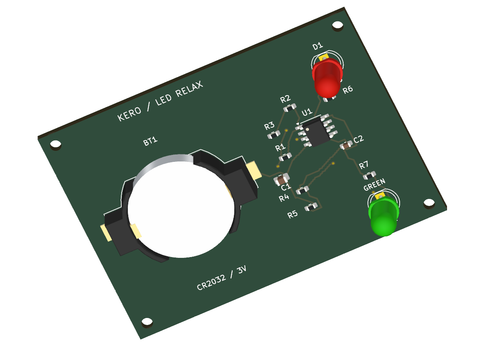

# KERO — coin-cell LED relaxation oscillator

An original, small KiCad project for demonstrating **schematic, PCB, BoM, 3D, commit and pull-request comparisons** in Pocket KiView.

One CR2032 cell powers an LMV358A dual op-amp and alternating red / yellow-green LEDs. The baseline is approximately **1.02 Hz**, calculated with ideal output swings; red is on for about **29%** of each cycle. The timing PR changes R1 from 1 MΩ to 470 kΩ, giving approximately **2.18 Hz**. This is a design/review demonstration; hardware has not been built or bench tested.

## Try the comparison demos

- [PR #1 — timing resistor / blink-rate change](https://github.com/wayri/KERO/pull/1)
- [PR #2 — LED placement and routing change](https://github.com/wayri/KERO/pull/2)
- [Baseline commit history](https://github.com/wayri/KERO/commits/main/)

Both PRs are intentionally open and unmerged. Each contains a design commit followed by a verification commit. [Follow the walkthrough](DEMO.md) to compare changes in Pocket KiView.

## Open the project

Open [KERO.kicad_pro](KERO.kicad_pro) in **KiCad 10** (verified with 10.0.6). The editable schematic, routed two-layer PCB, local symbol/footprint libraries, and all component 3D assets are included. Board dimensions are **63.50 × 45.72 mm**, nominal thickness 1.6 mm. Four M2 clearance holes are mechanical board-only items.

- [Schematic preview](previews/KERO.svg) · [PCB preview](previews/board.svg)
- [Bill of materials](bom.csv) · [Design intent and exact pin/net assignments](design-intent.json)
- [Native verification receipt](evidence/summary.json)
- [Demo walkthrough and comparison steps](DEMO.md) · [Rebuild and validation](BUILD.md)

## How it works

U1B buffers the quarter-supply divider formed by R4 (300 kΩ) and R5 (100 kΩ). U1A uses R2 (402 kΩ) and R3 (100 kΩ) for positive feedback, creating nominal thresholds near 0.201 × VBAT and 0.400 × VBAT. R1 and C1 slowly charge/discharge the timing input between these thresholds. U1A switches on each crossing, creating a relaxation oscillator.

When OUT is high, R6/D1 source current into the red LED. When OUT is low, R7/D2 sink current from the green LED. Each LED has its own 3.3 kΩ current-limiting resistor. The LEDs alternate with unequal on-times; this is intentional.

The thresholds stay below 0.41 × VBAT, within the LMV358A's specified input common-mode range over the intended **2.5–3.3 V** supply range. Use **LMV358ADR** in SOIC-8; a standard LM358 is not a suitable drop-in choice for this coin-cell design. See the [TI datasheet, input common-mode range and output swing sections](https://www.ti.com/lit/ds/symlink/lmv358a.pdf).

## Assembly and limits

Fit one CR2032 in the Keystone 1058 holder with the marked polarity. The cell is a separate purchased item in addition to BT1's holder. Remove it to switch off; there is no power switch or reverse-cell protection. Use a low-current, low-forward-voltage red LED and **yellow-green** LED (5 mm, 2.54 mm pitch); avoid high-Vf blue/InGaN green parts. Match the cathode/flat to the footprint. Generic LEDs/passives in the BoM are specification selections, not verified distributor stock or exact manufacturer parts.

At 3 V, ideal LED currents are roughly 0.2–0.4 mA for the specified LED types. Real brightness, output swings, C1's effective capacitance, temperature, startup, frequency and useful battery life require bench measurements. Operation below 2.5 V is outside the specified design range; no full-cell-discharge life claim is made. Do not recharge a primary CR2032.

## Models and attribution

All links use project-relative paths. Resistor, capacitor, op-amp, holder and LED STEP geometry comes from the installed KiCad 10 libraries. D2 uses a green-colour derivative of the standard red LED model. The separate CR2032 mesh is an original nominal 20 × 3.2 mm envelope for illustration, not a manufacturer fit-qualified model. Mounting holes have no physical component body or 3D model.

KiCad library assets retain their original [library license](LICENSE.KiCad.md), **CC-BY-SA-4.0 with the KiCad libraries exception**. See [asset provenance](ASSETS.md) and [model manifest](model-manifest.json). No IRCA files or proprietary thermal-camera circuitry are included.
