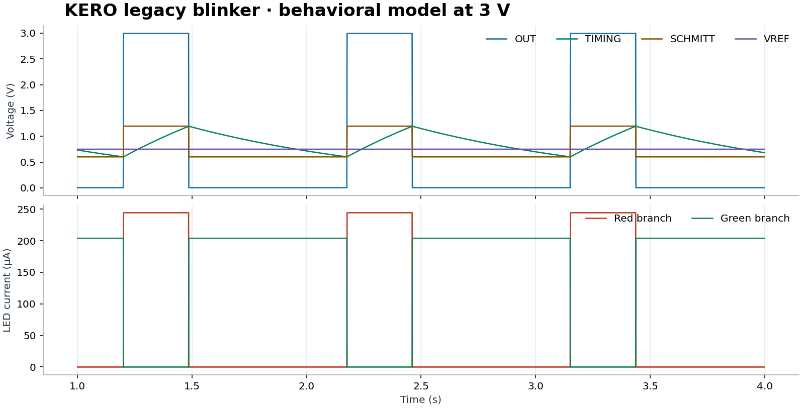

# KERO legacy blinker simulation plots

Open the root KERO project in KiCad Online. Under **Simulation → Result file**, choose [KERO-blinker.wbk](KERO-blinker.wbk), then bind [legacy-blinker.csv](legacy-blinker.csv) under **Saved result** on both tabs. **Oscillator and reference** plots OUT, TIMING, SCHMITT, and VREF. **Red and green LED currents** shows the alternating branch current. Use A/B cursors to compare pulse intervals and values.

The 3 V transient produced 8,001 saved samples. The modeled period is 0.976 s and the reference is 0.750 V. The red branch conducts while the modeled output is high, and green conducts while the output is low. [Run results](results.json)

The saved schematic supplies the R/C netlist and the recorded pin map supplies the two op-amp and LED connections. The as-saved KiCad netlist has no SPICE assignments for those components. The companion [ngspice deck](legacy-blinker.cir) uses two behavioral amplifiers, generic LED diodes, and an ideal 3 V supply with a 1 ms ramp. It leaves the KiCad schematic and PCB untouched. This is a functional oscillator model. It excludes the LMV358’s detailed behavior, battery losses, and measured LED output.

To reproduce, load the deck in ngspice and run the following in its console. The saved viewing data uses the linearized 1 ms grid.

~~~text
tran 1m 8 0 1m uic
let i_red=(v(/out)-v(/red_a))/4700
let i_green=(v(/vbat)-v(/green_a))/4700
linearize v(/vbat) v(/out) v(/timing) v(/schmitt) v(/vref) i_red i_green
set filetype=ascii
write legacy-blinker.raw v(/vbat) v(/out) v(/timing) v(/schmitt) v(/vref) i_red i_green
~~~
