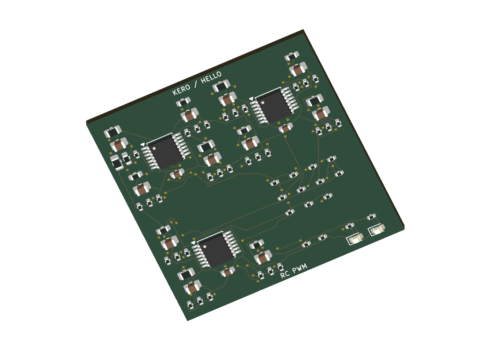
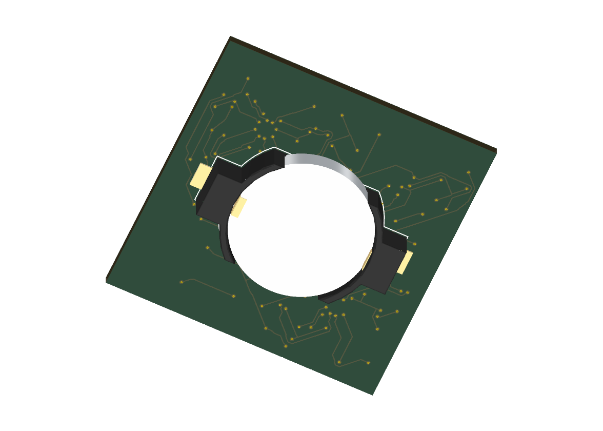

# KERO hello world encoder — draft hardware

> **AI hardware-design experiment:** KERO is an experiment to evaluate how well AI can generate and refine electronic schematics and PCB layouts. The designs are experimental candidates for engineering review and validation.

Executed [encoder cell-draw, PI and QuickTherm studies](analysis/README.md) are saved with native WayriCAD and Pocket KiView files.

Open [Encoder.kicad_pro](Encoder.kicad_pro) in KiCad 10. The [six-sheet schematic](Encoder.kicad_sch) implements an RC-programmed `hello world` PWM sequence using three TLV9044IPWR quad op amps, one CR2032 cell, and alternating red/green indication. See [circuit operation and timing](../encoded-model/architecture.md), [executed SPICE evidence](../encoded-model/spice/README.md), and [schematic/variables guide](SCHEMATIC.md).

| Saved design check | Result |
|---|---|
| Native schematic ERC | 0 violations |
| Components / pad assignments | 79 / 194; exact intent and schematic parity |
| Board size | 40 × 40 mm; 44.9% less area than the original blinker |
| Placement | Front circuit, bottom coin-cell holder |
| Native routing status | **Complete: 0 open connections; all 40 nets connected** |
| Native DRC / schematic parity | 0 reported findings / 0 mismatches |
| Models | All 79 fitted parts resolve local standard package models; nominal cell is illustrative |

The routing repair removed dangling terminal stubs and negotiated alternate copper paths without moving components or changing the circuit or rules. [Revision comparison](evidence/routing-change.json) records only track/via changes; [circuit equivalence](evidence/circuit-equivalence.json) independently checks all 79 parts and 194 assignments against the simulated design. The native ERC, DRC, parity and connectivity checks pass. Five pre-existing default ignored DRC checks remain listed in the report; no severities or exclusions were changed.

This is a review candidate, not a fabrication release. [Board validation](evidence/board-validation.json) lists the connected pad partitions and check settings; [native DRC](evidence/board-drc.json) retains all reported findings. Source hashes were checked against the files being published. KiCad local preference files and tool scratch are excluded from Git; the original native command receipt retains the local preference-file hash as incidental execution context.

The [BoM](bom.csv) contains values, packages, manufacturer/MPN fields and ratings. Exact passive and LED order codes remain unverified and are marked `Select to specification`; no procurement closure is claimed. The CR2032 cell is a separate assembly consumable from BT1, the Keystone holder. Local KiCad libraries and package models follow the repository [asset provenance](../ASSETS.md) and [KiCad library license](../LICENSE.KiCad.md).

The root `KERO.kicad_*` files remain the earlier validated blinker. Saved PI/QuickTherm files under `../analysis/` describe that root board only; no new encoder PI or thermal solve is represented by those files.
