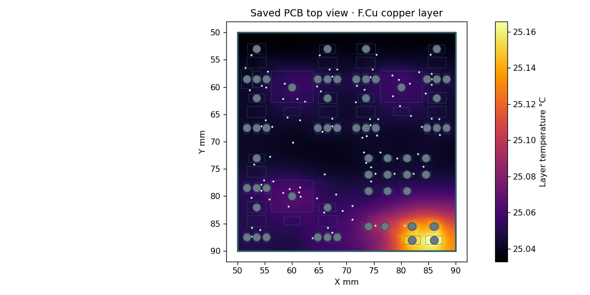

# Corrected encoder: cell draw, copper PI and QuickTherm

These are executed Xyce and WayriCAD 4.5.0 studies for `encoder/Encoder.kicad_pcb`, SHA-256 `08437dcfd8f304786d4f3444a26bd56c443661ea22bd25d69c3900906c6ef109`. They describe the routed encoder, separately from the earlier root blinker analysis. Native design checks remain in `../evidence/`; the board source is unchanged by these studies.

| Nominal 3 V result | Calculated value |
|---|---:|
| Cell average / RMS | 279.081 / 279.149 µA |
| Largest sampled settled / 1 ms startup current | 290.788 µA / 1.174 mA |
| Component heat input | 837.244 µW |
| Op amps / resistors / LED electrical absorption | 359.082 / 338.275 / 139.887 µW |
| VBAT mean-load drop / copper loss | 45.762 µV / 8.472 nW |
| GND mean-load rise magnitude / loss, finer mesh | 11.138 µV / 2.005 nW |
| VBAT noncoincident envelope drop / loss | 70.082 µV / 19.244 nW |
| GND noncoincident envelope rise / loss | 19.624 µV / 4.425 nW |
| QuickTherm top / bottom board maximum | 25.1656 / 25.1520 °C at 25 °C ambient |
| Largest component change, 40 vs 80 thermal grid | 0.006152 °C |

[Power budget and accounting](power/README.md) includes the full lossless compressed waveform, 78 component power rows, terminal load maps, integration checks, cell internal-resistance scenarios, and retained vendor-model discrepancies. All two complete captured frames decode `hello world`. The native binding files and generator hashes are retained. No measured cell ESR, capacity, battery lifetime or hardware performance is claimed.

## PI files and limits

Each case has a `.quick-pi.results.json` for native WayriCAD and a `.pocket-kivi.json` for Pocket KiView. [Study inputs](pi/Encoder.quick-pi.study.json), [load cases](pi/load-cases.json), [refinement summary](pi/summary.json), [native export receipts](pi/export-receipts.json) and the execution log are saved. Four cases cover VBAT/GND mean loads and simultaneous per-pad absolute-current envelopes. The envelopes are stress scenarios whose maxima do not occur simultaneously; they are not actual cell peaks.

Global drop and loss changes are below 1% across the last two refinements for the four primary cases. Local current-density peaks remain unconverged: the last VBAT refinement changes its reported peak by about 49.8%. These fields do not establish local ampacity. PI assumes fixed 20 °C copper, 35 µm top/bottom copper, a 1.6 mm outer span and 25 µm via plating. Contact resistance and battery source impedance are excluded.

The mean GND mesh leaves a front-layer region at X 66.95–67.95 mm, Y 54.775–56.225 mm unresolved, coinciding with the C4 ground pad. The saved 0.075 mm case reports 614 floating nodes / 1,154 triangles. A separate [0.05 mm check](pi-ground-refinement/summary.json) leaves 1,239 / 2,384 floating, while changing drop/loss by only about 0.20% / 0.24%. Missing values are preserved; this is a model coverage limit, not evidence that the native PCB has an open net. The native PCB connectivity check still reports all 40 nets connected. The GND envelope case reports no floating regions. No artificial load, geometry edit or solver-check relaxation was used to fill the gap.

Ground studies reverse the return currents and use a mathematical 3 V reference. Interpret solved drop magnitudes as physical ground rise; the plotted approximately 3 V potentials are not the board ground voltage. Cycle-mean DC loss is not waveform-average I²R loss. Ground pin currents use the explicitly documented vendor-model return assignment.

## QuickTherm files and limits

[Native fine result](thermal/nominal.results.json), [portable result](thermal/nominal.pocket-kivi.json), [producer HTML report](thermal/nominal.html), original JSON, both grid configurations/results, [model inputs](thermal/model-inputs.json), [summary](thermal/summary.json) and execution log are retained. The 80 × 80 two-layer grid uses 64 positive component heat sources. Heat-balance residual is about 5.29 fW; that numerical closure does not establish physical accuracy.

This is a steady board-temperature screen using simulated cycle-average component dissipation, with all LED electrical absorption assigned to heat. It assumes FR4 k=0.3 W/m/K, copper k=385 W/m/K, natural-convection h=5 W/m²/K on two exposed faces, no radiation, and no enclosure or holder/battery shadowing. All junction temperatures remain unknown because no package-to-board thermal resistances were supplied. Cell internal heat and capacitor ESR/loss are unknown. The nominal mean-load PI conductor loss totals about 10.477 nW, approximately 0.00125% of component heat, and is reported separately rather than deposited into this thermal solve. This is not an electrothermal feedback solve or a startup/junction-temperature guarantee.

## Open in the extension

Open the encoder PCB and one selected `.pocket-kivi.json` at the same revision. Select potential, loss or current-density fields for PI, or top/bottom board temperature for QuickTherm; check the matching source SHA before interpreting overlays. Every portable file is below the 64 MiB analysis-reader limit. [Viewer validation](viewer-validation.json) exercises the actual extension data reader, spatial conversion and saved-value probing: 32 supported surfaces across six files, all matching this PCB. These are API/data checks, not new browser gestures.

Native generation receipts report current source and restorable results. Thermal readbacks occurred before atomically moving the unchanged staged files to their final folder; their raw receipts retain those execution paths. A redundant consolidated native readback attempt exceeded its 60 s tool budget and is not reported as a pass. The already completed generator readbacks and portable-reader checks remain the recorded evidence. The finer-mesh folder also retains the initial project-relative-path request error and the corrected absolute-path execution.
