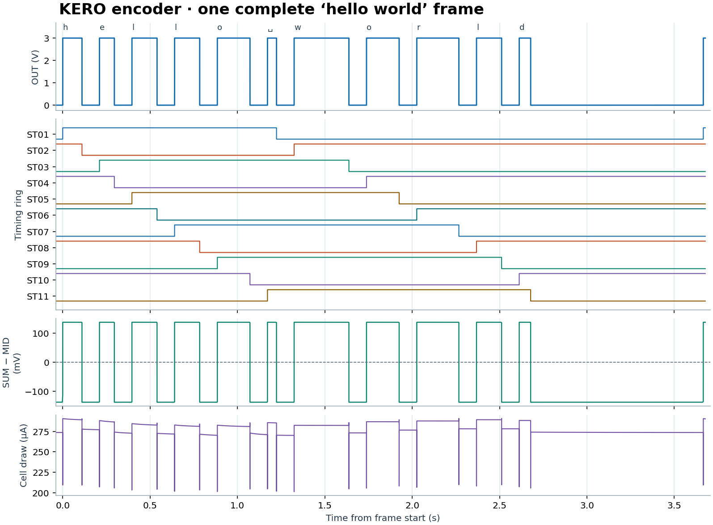
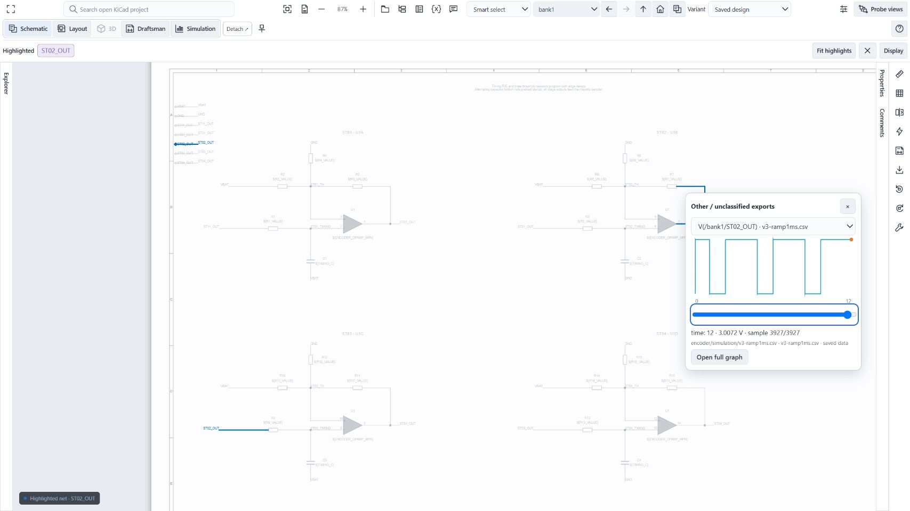

# KERO encoder simulation plots

Open **Simulation** in KiCad Online and select [KERO-encoder.wbk](KERO-encoder.wbk) in **Result file**. Choose a workbook tab, then bind its CSV under **Saved result**. The workbook stores plot settings and cursor positions. The CSV files carry the simulated samples.

| Workbook tab | Saved result |
| --- | --- |
| 3.0 V · 1 ms, 11 ring outputs, Cell current, Cell power | [v3-ramp1ms.csv](v3-ramp1ms.csv) |
| 2.5 V · 1 ms | [v2p5-ramp1ms.csv](v2p5-ramp1ms.csv) |
| 3.3 V · 1 ms | [v3p3-ramp1ms.csv](v3p3-ramp1ms.csv) |
| 3.0 V · 100 ms | [v3-ramp100ms.csv](v3-ramp100ms.csv) |
| 3.0 V · 1 s | [v3-ramp1s.csv](v3-ramp1s.csv) |
| 3.0 V · 1 ms, refined | [v3-ramp1ms-refined.csv](v3-ramp1ms-refined.csv) |

Use the signal checkboxes to show OUT, the divider and summing node, or any of the eleven timing-stage outputs. The current and power tabs keep those units on separate plots. **Zoom area** isolates one pulse. **Cursor A** and **Cursor B** snap to saved points. Cursor differences can differ slightly from the interpolated threshold crossings used to decode a frame.

The top panel labels the pulse widths that decode to **hello world**. The middle panels show the eleven stage outputs thresholded at half the 3 V supply for readability, and the decoder's SUM minus MID voltage. The bottom panel shows positive source draw. All plotted panels use the same nominal frame timebase.

## Probe the schematic

1. Open the Encoder schematic. Use **Simulation → Saved KiCad / wayriCAD results**, then use **Link net plots** beside the CSV for the supply case you want.
2. Choose a voltage in the new **Saved waveform signal** list to jump to the exact sheet and highlight the wire. Or close the reports panel and click the net in the schematic to open its waveform.
3. Click the inset plot or move its **Saved sample** slider to inspect voltage and time. Use **Open full graph** for a larger plot.

For example, **ST01_OUT** probes the same waveform on the root schematic, bank 1, and the decoder. **VBAT** is probeable on all six sheets. **ENCODED_OUT**, **MAJORITY_SUM**, and **MIDREF** resolve to the decoder. Each connected sheet occurrence has its own qualified voltage column with the same saved sample values. The workbook selects one column per signal by default. [Recorded net mappings](results.json)

## Reproduction and limits

At the published schematic revision all six fresh Xyce 7.8 runs completed and reproduced the original full-waveform hashes. Ten complete frames decoded correctly. At nominal supply the last complete frame measured about 3.666 s, with approximately 279 µA mean simulated source draw. [Run results and hashes](results.json) · [Original full waveforms and reproduction instructions](../../encoded-model/spice/README.md)

The CSVs are sample subsets of the solver output. They retain the output transition brackets and the sampled source-current peak. Current is minus the simulated voltage-source current. Power is that current multiplied by VBAT. The model uses the TI TLV9042 Rev. B family macro per TLV9044 channel, generic LEDs and an ideal ramped battery source. The runs characterize the simulated circuit and leave component tolerance, temperature, battery life, optical output and hardware qualification outside their scope. The model description and separate PI and thermal results are in the [encoder analysis guide](../analysis/README.md).
